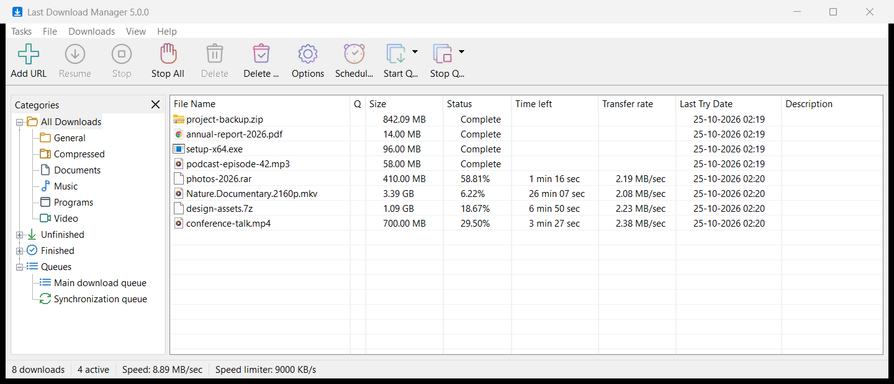
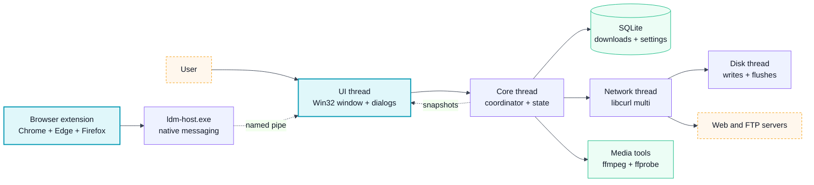

<div align="center">
  

  # Last Download Manager

  **A fast, native download manager for Windows, with browser and video capture built in.**

  Multi-connection downloads that survive restarts, a classic list window, browser extensions for Chrome, Edge and Firefox, and one-click downloads of the videos playing on a page, HLS and DASH streams included.

  <p>
    
    
    
    
    
    
    
  </p>

  <p>
    <a href="https://github.com/xMags/Last-Download-Manager/releases/latest/download/LastDownloadManager-windows-x64-setup.exe"></a>
    <a href="https://github.com/xMags/Last-Download-Manager/releases/latest/download/LastDownloadManager-windows-x64.zip"></a>
    <a href="https://github.com/xMags/Last-Download-Manager/releases/latest/download/LastDownloadManager-browser-extension.zip"></a>
  </p>

  <p>
    <a href="#install">Install</a>
    ·
    <a href="#features">Features</a>
    ·
    <a href="#architecture">Architecture</a>
    ·
    <a href="#roadmap">Roadmap</a>
    ·
    <a href="#development">Development</a>
    ·
    <a href="#browser-extension">Browser extension</a>
    ·
    <a href="#license">License</a>
  </p>

  
</div>

> [!NOTE]
> Last Download Manager 5 is a complete rewrite: the previous wxWidgets version (1.x and 2.x) has been retired, and the new app is plain Win32 C++ with no web views. If the old version is installed, uninstall it first; it installed for all users into Program Files, while version 5 installs for your user only.

---

## Install

1. Download [**LastDownloadManager-windows-x64-setup.exe**](https://github.com/xMags/Last-Download-Manager/releases/latest/download/LastDownloadManager-windows-x64-setup.exe) and run it. It installs for your Windows user only and needs no administrator rights. It registers the browser helper, so the extension can reach LDM right away, and can start LDM in the notification area when you sign in.
2. Add the browser extension: load it from [**LastDownloadManager-browser-extension.zip**](https://github.com/xMags/Last-Download-Manager/releases/latest/download/LastDownloadManager-browser-extension.zip) as described in [Browser extension](#browser-extension). Store listings for Chrome, Edge and Firefox are on the way.

> [!IMPORTANT]
> The installer is not code-signed yet, so Windows SmartScreen may say "Windows protected your PC". Choose **More info**, then **Run anyway**. The message goes away as more people install the release.

**Portable:** [**LastDownloadManager-windows-x64.zip**](https://github.com/xMags/Last-Download-Manager/releases/latest/download/LastDownloadManager-windows-x64.zip) holds the same program. Unzip it to a folder of your choice and run `ldm.exe`, keeping `ldm-host.exe`, `ffmpeg.exe` and `ffprobe.exe` beside it.

**Uninstalling** keeps your download list and settings unless you choose to delete them too; downloaded files are never deleted. Every release is listed on the [releases page](https://github.com/xMags/Last-Download-Manager/releases/latest).

---

## Features

### Downloads

- Multi-connection HTTP, HTTPS and FTP downloads: connections ramp up, split the largest remaining part, and check that the bytes each one fetches agree.
- Resume after a pause, a crash or a restart. Only bytes flushed to disk count as done, and a file that changed on the server is never mixed with the old one.
- Automatic retries with backoff, `Retry-After` support, and a clear reason when a download fails.
- Per-download and global speed limits, a download quota, and per-server connection limits.
- System, PAC script and manual proxies, with site logins and passwords protected by Windows DPAPI.
- Categories that route files into their own folders, duplicate handling, and Move and Rename.

### Browser integration

- Extensions for Chrome, Edge and Firefox hand downloads to LDM with the browser's cookies, referrer and form data.
- Right-click menu entries: download a link, the page, the selected links, or every link on a page through the Download All Links dialog.
- File-type rules, site exceptions, and keyboard modifiers to force or skip capture.

### Video and stream capture

- A download panel appears over videos playing in the browser and lists each quality, video only, audio only and subtitles.
- HLS and DASH streams download in pieces several at a time, resume piece by piece, and decrypt AES-128 as they arrive.
- FFmpeg joins the tracks into MP4, or MKV when MP4 cannot hold them, and writes the resolution, codecs and length into the description. Subtitles save as WebVTT.
- Streams from the internet are never allowed to make LDM send requests into your home network.

### Queues and scheduler

- Download queues that run a set number of files at a time, retry failed ones, and start and stop at the times you set, once or on chosen weekdays.
- A synchronization queue that checks finished files for changes on the server and downloads only what changed.
- After a queue finishes: exit LDM, sleep, hibernate or shut down, with a countdown you can cancel.
- How it works: [Queues and the Scheduler](docs/help/queues.md).

### Site Grabber

- Explores a site from a start page, as deep as you choose, and lists the pictures, audio, video or other files it links to, with templates for the common cases.
- Filters by file type, size, folder and site, then downloads the files you check, keeping the site's folders if you like.
- Saves whole pages for offline browsing, with their links pointing at the saved copies.
- Signs in with a user name and password, or with the cookies of your browser, and runs on a schedule.
- How it works: [Site Grabber](docs/help/site-grabber.md).

### Windows app

- Native Win32 window with a category tree, sortable columns, progress windows and a system tray icon.
- Light and dark themes, per-monitor DPI scaling, clipboard monitoring and a drop target.
- Import and export of download lists, batch downloads, and command-line adds.
- An optional check for new versions, which only shows a notice and never installs anything by itself.

---

## Architecture



One coordinator on its own thread owns all download state and the database; the UI only reads immutable snapshots of it. Transfers run on a libcurl network thread and hand their bytes to a disk thread, and every run carries an epoch, so a late event from an older run can never change a newer one. FFmpeg runs as a separate process that only reads local files.

---

## Roadmap

| Milestone | Scope | State |
| --- | --- | --- |
| 1 | Feature study and plan | Done |
| 2 | Native shell and reliable downloads | Done |
| 3 | Browser integration and media capture | Done |
| 4 | Queues, scheduler, organization and Site Grabber | Done, in final testing |
| 5 | Installer, update check and first release | In progress: the release and the store listings are next |

---

## Development

Prerequisites: Windows 10 or 11 (x64), Visual Studio 2026 with the "Desktop development with C++" workload (MSVC, CMake, Ninja and vcpkg), and Node.js 22 or newer for the browser extension and the integration tests.

Open a **Developer PowerShell for VS** so the compiler, CMake, Ninja and vcpkg are on `PATH`, then run from the repository root:

```powershell
cmake --preset windows-release
cmake --build --preset windows-release
```

The first configure builds the dependencies (libcurl, SQLite, FFmpeg, nlohmann-json, GoogleTest) through vcpkg, which takes several minutes. The app is written to `build/windows-release/src/app/ldm.exe`, with `ldm-host.exe`, `ffmpeg.exe` and `ffprobe.exe` beside it.

Use the `windows-debug` preset for a debug build, `windows-asan` for AddressSanitizer, and `windows-analyze` for MSVC code analysis.

To make the release files the download buttons point to, run `cmake --build --preset windows-release --target ldm_installer` (or `ldm_package` for the archives without the installer, which needs [Inno Setup 6](https://jrsoftware.org/isinfo.php)). They are written to `build/windows-release/package/`. The whole release process is in [docs/releasing.md](docs/releasing.md).

---

## Browser extension

The extension comes in the release archive above, or, when Node.js is installed, the build writes it to `build/extension/`. Either way there is one folder per browser family. Until it is published in the browser stores, load it by hand:

- **Chrome or Edge:** open `chrome://extensions` (or `edge://extensions`), turn on Developer mode, choose **Load unpacked** and pick the `chromium` folder.
- **Firefox:** open `about:debugging#/runtime/this-firefox`, choose **Load Temporary Add-on** and pick `manifest.json` in the `firefox` folder. Firefox removes it when it restarts.

LDM registers its browser helper (`ldm-host.exe`) when it is installed and every time it starts. With the portable zip, start LDM once before loading the extension.

The extension sends what it hands over only to LDM on your computer; see the [privacy policy](docs/privacy-policy.md).

---

## Quality checks

| Suite | Command |
| --- | --- |
| Unit and integration tests | `ctest --preset windows-release` |
| Extension tests | `node --test extension/test/*.test.mjs` |
| Test server tests | `node --test tests/fixture-server/*.test.mjs` |

The integration tests drive the real engine against a local HTTP and FTP test server and download generated HLS and DASH videos, so they need Node.js.

---

## Repository layout

```text
src/
  app/              ldm.exe entry point and wiring
  base/ model/      shared types, the download model and settings
  core/             coordinator, commands, ports, snapshots, queues and scheduler
  grabber/          Site Grabber: link scanning, filters and the explorer
  engine/           libcurl transfers, stream runs and the disk writer
  media/            HLS and DASH parsing
  browser/          browser messaging protocol
  storage/          SQLite store and migrations
  ui/               Win32 window, dialogs and the media panel
  platform/win/     Windows services: proxy, FFmpeg, browser host link
  host/             ldm-host.exe, the native messaging host
  resources/        icons, manifest and dialog resources
extension/          browser extension source and its build script
installer/          Inno Setup script for the Windows installer
docs/               privacy policy, release process and store listing texts
tests/              unit and integration tests, test servers
cmake/              vcpkg triplet, release packaging, installer and license notices
```

## License

Last Download Manager is free software under the [GNU General Public License v3.0](LICENSE). The bundled FFmpeg build is LGPL. Every release carries `THIRD-PARTY-NOTICES.txt` with the versions and licenses of the components it ships.
